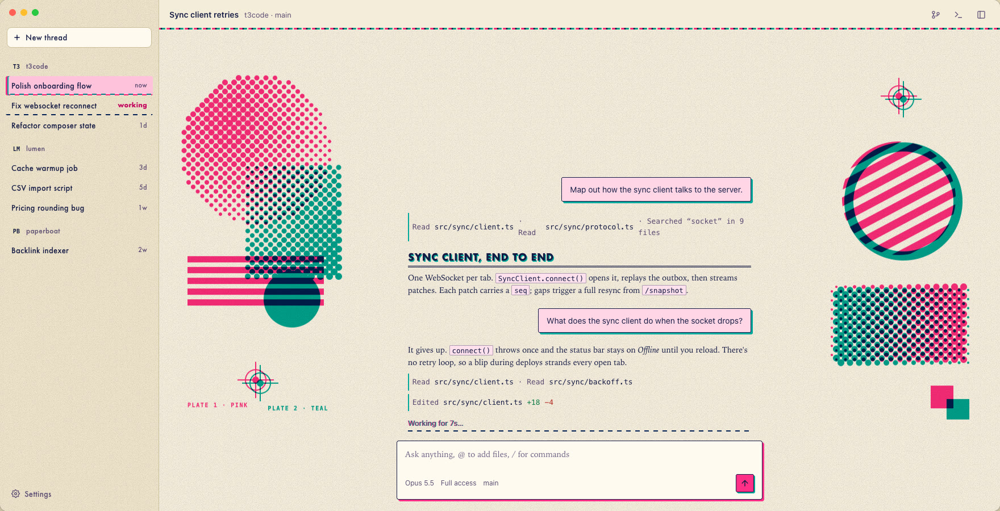

# Misprint

**A two-ink print theme for [T3 Code](https://t3.codes).** Fluoro pink and teal on cream stock. While your agent works, the two ink plates slip out of register and clack between offsets. When the turn ends they snap back into place and the overlap goes deep indigo.

**[See it in motion](https://joshsaintjacque.github.io/t3code-theme-misprint/)**



## Install

**From the app**

1. Download [`misprint.json`](misprint.json), or copy its contents.
2. In T3 Code, open **Settings > Appearance > Add theme**.
3. Choose the file, or paste the JSON, and add it.

**From the terminal**

```sh
curl -fsSL -o misprint.json https://joshsaintjacque.github.io/t3code-theme-misprint/misprint.json
~/.t3/bin/t3 theme set misprint.json
```

`t3 theme set` publishes the file and sets it as the environment theme, so every client connected to that environment switches to it.

Tested on T3 Code 0.1.11 (nightly).

## What moves, and when

Every animation is tied to real app state. If nothing is running, nothing moves.

| | |
|---|---|
| **Gutter plates** | On wide windows the margins hold a halftone test print, one layer per ink. During a turn they slip and clack between offsets; at rest they sit perfectly registered and overprint. |
| **Header rule** | A dashed rule printed in both inks. The inks drift apart while a turn runs. |
| **Busy threads, Working row** | Two dashed rules march in opposite directions under any busy thread and under the live Working row, whose text gets ghosts of each ink. |
| **Turn complete** | The plates snap home with an overshoot, like a registration pin seating. |
| **Composer** | A pink offset plate at rest. Focus prints the teal plate on the opposite corner. |
| **Hover** | Thread rows grow a pink rule from the left and a teal one from the right; they overprint where they meet. |
| **Narrow windows** | No room beside the chat? A small proof sheet docks above the sidebar footer. |

`prefers-reduced-motion` freezes everything to the registered still.

## Palette

| Role | Hex |
|---|---|
| Canvas | `#F5EDDB` |
| Sidebar | `#EFE4CA` |
| Message | `#FFD6E7` |
| Text | `#261A40` |
| Muted | `#5A4A72` |
| Accent (pink) | `#FF2E88` |
| Focus (teal) | `#00877F` |
| Update (teal) | `#007A73` |
| Code | `#FBF7EA` |
| Error | `#B3261E` |
| Teal ink (CSS) | `#00A99D` |

## Make your own variant

`misprint.json` is generated. Edit [`source/build.py`](source/build.py) and run `python3 source/build.py`. The landing page is built from `source/site_template.html` by `source/build_site.py`.

Not affiliated with T3. MIT licensed.
